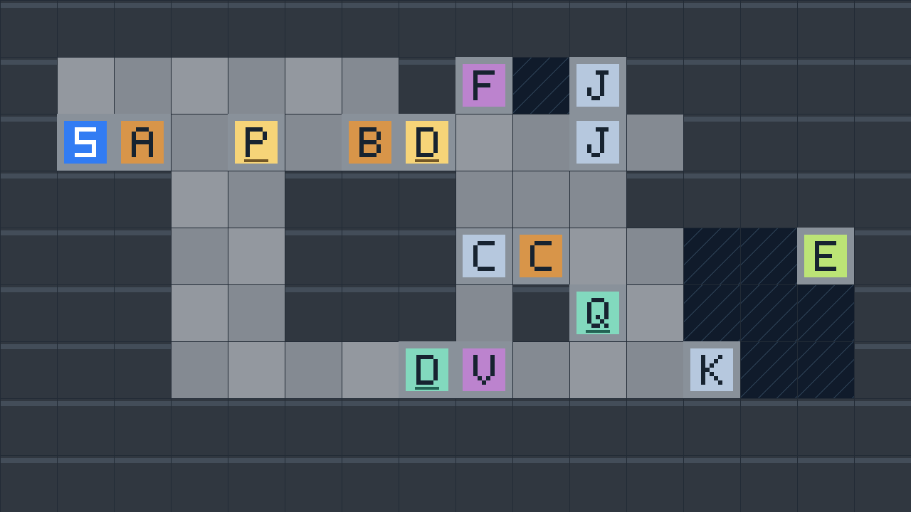

# 七关地图草案

## 关卡要求

- 关卡按 16:9 横屏构图。第七关用 16 列 × 9 行做逐格样板，其他关卡细化时也优先把路线横向折返。第六关和第七关均采用 16 列 × 9 行格图。
- 玩家和箱子以一格为占位单位。2.5D 四方向输入每步一格。2D 先对比 1 格、1.5 格、2 格三档跳高，再定全局数值。跳台是否必需同时取决于跳高、横向速度、起跳站位和可切回的落点。

- 2.5D 是主形态，角色和可推箱逐格移动。2D 是同一张地图的正顶视图，角色左右跑跳，重力沿图面向下。切换保留当前地图坐标，空中也能切换。
- 所有关卡使用同一种出口，进入出口区域即通关。第 1、2、3、6 关通过地形引导玩家最后用 2.5D 走到出口。第 4、5 关把出口放在断地板的区域内，最后一段需要 2D 跳跃。2.5D 保留空中切换，但角色在洞上切换时不能借相邻格继续行走，也不能在洞上触发出口。
- 只要切入 2D，画面内所有指定落块同时沿图面向下自由落体，受同一重力加速度，在撞到实体后停止。切回 2.5D 时保留当时的位置。草案暂按同时保存竖向速度处理，再切入 2D 时继续下落。各块的先后差来自起始位置、需要让开的通道位置和挡块高度。
- 第 5 关引入箱子压板。箱子留在压板上时门保持开启，箱子移开时门关闭。第 6 关综合第 1 关的跨洞和第 2 关的落块。
- 草图每个字符代表一格。图上方是 2D 起跳方向。初稿用于核对路线和机关顺序，教学关以查验后的地图为准。

图例：`S` 出生点，`.` 普通地板，`~` 2.5D 无地板的洞，`#` 固定实体兼 2D 平台，`F` 2D 落块，`B` 2.5D 可推箱，`P` 压板，`D` 门，`E` 出口。棋盘地板在 2D 中是背景，角色踩在实体的上边缘。

## 机制积木与组合规则

**2.5D 用来走位和搬东西，2D 用来跳过地面走不过去的地方。** 两种形态共用一张地图：上一段留下的角色、箱子和机关位置，就是下一段的起始条件。

| 记号 | 原子操作 | 成立条件 → 结果 |
| --- | --- | --- |
| `W` | 2.5D 走格 | 四方向逐格走，目标格要有地板且无阻挡。可以沿连续地板向图上方走到 2D 视图里的「天上」：这是换排，能到达单次跳跃够不到的图面位置。 |
| `PUSH` | 2.5D 推箱 | 人站在箱子背后，箱子前一格有支撑且空闲 → 人、箱各进一格。到新位置后，箱子可以压板，也可以在 2D 当踏台。 |
| `JUMP` | 2D 左右跑跳 | 从固定实体、箱子或可接住人的落块边缘起跳 → 越洞、登上平台或触及出口。用实际轨迹核对净空、横向距离和落脚边缘。 |
| `IN` | 切入 2D | 保留地图坐标 → 获得跑跳能力；所有指定落块一起开始或继续下落。 |
| `OUT` | 切回 2.5D | 保留切换点并冻结落块，可在空中切回 → 要接着走，切回点必须有可走的地板；洞上不能靠对格继续走或触发出口。 |

洞、墙、平台、箱子、压板门和落块是**操作的条件或结果**。画草图时可以先写式子：`→` 表示顺序，`[条件]` 表示必须满足的门槛，`×n` 表示重复。每个箭头都要能接上前一步留下的**站位、物件状态和时间**。

| 组合 | 设计式 | 现有例子 |
| --- | --- | --- |
| 跨洞再换排 | `W 到洞边 → IN → JUMP → OUT [对岸有地板] → W 向上到出口` | 01 |
| 放落块让路 | `IN [等落块清空通路] → OUT → W 通过` | 02 |
| 冻结后再跨洞 | `IN → OUT [上廊已开、下廊仍通] → W → IN → JUMP → OUT → W 折返` | 03；第二次 2D 会继续推进落块 |
| 搬箱延长跳跃路线 | `PUSH×n → W 到起跳位 → IN → JUMP 到箱上 → JUMP 到出口` | 04 |
| 用箱保留一条路 | `PUSH [箱在压板上] → W 过门 → IN → JUMP 到出口` | 05 |
| 一次跳跃同时改变两处地形 | `IN → OUT [A 让出上廊] → W 换排 → IN → JUMP 接 B → JUMP 到左岸 → OUT → W 过 A` | 06；B 要接得到，A 也不能封住回程 |
| 跳到推箱背面，换箱子用途 | `A 压板开门 → B 过门 → IN → JUMP → OUT [到 B 背面] → B 压板开新路 → A 离板运到终点当踏台` | 07；运 A 经过喉口前，F 不能落底 |

策划新关时，先写一条成功式，再决定哪些元素要**重复**（如两次推箱）、**串联**（如推箱产生踏台，踏台产生可跳路线）或**联动**（如一次跳跃同时消耗两块落块的时间窗口）。对每次切换标出进入和返回的坐标；对每次推箱标出背后的站位、箱子目标格和推完后的退路。涉及落块时，把所有 2D 段的跑、跳和等待时间一起算；哪些位置能通过、哪些踏台能接住人，要在同一条试玩轨迹里成立。最后去掉一个关键操作再试一遍，例如空手跳、全程只用一种形态或让落块落底，确认玩家确实需要这组操作。跳高、可跳距离和时间窗口用灰盒实测定稿。

## 01 · 跨过一格洞

```text
#########
#...~..E#
#...~...#
#S..~...#
####~####
#########
```

2.5D 向右走到洞边，切成 2D 后从下方实体边缘起跳，越过一格洞。到达对岸时可在空中切回 2.5D，再向上走到绿色出口 `E`。出口比起跳格靠上两行，当前跳高 1.2 格时无法全程用 2D 到达。洞边上方留出两格净空。洞贯穿通路两侧，2.5D 无法绕行。

## 02 · 让路

```text
#########
#######E#
#######.#
#S..F...#
####.####
####.####
#########
```

落块堵在唯一通向出口的横廊上，下方凹槽容纳落块。玩家先在安全处切入 2D，观察 `F` 落进凹槽并由底墙托住。切回 2.5D，从原来被挡住的位置通过。凹槽缩为一格宽，保证落块移动前无法绕过；出口位于右端向上两格的支路，引导玩家切回 2.5D 换排。

## 03 · 卡住落块，再跨洞

```text
#################
##########..~...#
##########..~...#
#S..F.......~...#
####~#######~##.#
####~#######~##.#
####~##########.#
####~##########.#
####~##########.#
####~##########.#
####~##########.#
####~##########.#
####~##########.#
#E..............#
#################
```

上横廊的 `F` 沿竖井落向下横廊。上路右端是洞，洞两侧的起跳净空在上方两行。右边竖廊接回下横廊，出口在左端。下横廊一格高，落块到底后会填满通道，无法跳过。

1. **冻结落块。** 在起点短暂切到 2D，看见方块完全离开上横廊、进入竖井中段后切回 2.5D。太早切，上路仍堵。太晚切，下路被堵。
2. **跨洞。** 走到洞左侧，切成 2D 向右跳过一格，在抵达对岸后立即切回。落块在这次跳跃期间会继续下落，冻结时要为这次跳跃留出余量。
3. **回到下横廊。** 沿右侧竖廊下行，向左经过落块下方走到出口。下廊的低顶让玩家只能通过已经让开的空格。

灰盒把上下横廊拉开十格，竖井内没有 2.5D 地板，避免玩家沿井直接走到下廊。两次切换共用落块的下落时间，验收时分别尝试太早切、太晚切和全程等待落底。

## 04 · 推箱做踏台

Unity 灰盒使用 14 列 × 6 行格图。坐标从左上角 (0,0) 起，`K` 是带标记的箱子停靠格。

```text
~~~~~~~~~~~~~~
~~~~~~~~~~~~~~
~~~~~~~~~~~~E~
~~~~~~~~##~~~~
~SB...K.~~~~~~
#####~~~~~~~~~
```

1. **推箱。** 从 (1,4) 向右推四格，把箱子从 (2,4) 推到 K (6,4)。角色停在 (5,4)，再退到 (4,4)。
2. **借箱登台。** 在 (4,4) 切成 2D，从左侧平台边缘跳到箱顶，再从箱顶跳上右侧高台 (8–9,3)。
3. **跳进出口。** 从高台右半段起跳，跨过洞区进入 (12,2) 的绿色出口。出口格没有 2.5D 地板，洞上切回不能结算。

第四关沿用第三关的横移速度 4.25 格/秒和跳高参数 1.45 格。左侧平台到右侧高台的表面高差为两格，箱顶位于两者之间。箱子初始位置与高台的横向距离超出登台跳的范围。失足可按 R 重开，按 Z 撤回上一步。

## 05 · 推箱压住机关

Unity 灰盒使用 15 列 × 9 行格图。坐标从左上角 (0,0) 起。

```text
~~~~~~~#~~~~~~~
~~~~~~~#~~~~~~~
~~~~~~~#~~~~~~~
~~.....#~~~~~~~
~S.B.P.D...~~E~
~##########~~~~
~~~~~~~#~~~~~~~
~~~~~~~#~~~~~~~
~~~~~~~#~~~~~~~
```

1. **压住开关。** 从 (1,4) 向右走到箱子背后，把 B 从 (3,4) 推两格到压板 P (5,4)。箱子在板上时门保持开启，推过压板会关门。
2. **绕箱过门。** 角色从 (4,4) 向上，经第 3 行绕到 (6,4)，再穿过门 D (7,4)。分隔墙向上超过左侧可到达的跳跃高度，向下延伸到坠落重置线以下。
3. **跳进出口。** 在右岸 (10,4) 切入 2D，向右跳三格，穿过断地板区域进入 E (13,4)。

## 06 · 给回程留一条路

按应用值设计。玩家跳跃初速度 5.33 格/秒、横移 4.25 格/秒、下落加速度 9.81 格/秒²。落块下落加速度 2.45 格/秒²。2.5D 每 0.18 秒走一格。

### 16 × 9 格图

坐标从左上角 (0,0) 起。A、B 是落块，C 是可推箱，c 是承托格，v 是 A 可能封住的回程格，T 和 L 是右岸起跳位和左岸落脚位。A 的竖井 (4,2)、(4,3)、(4,5) 为无地板空域，c 有 2.5D 地板供 C 停靠。B 正下方 (10,7) 的点是竖井中的空位，2.5D 无地板，(10,8) 的固定墙从下方托住 B。

```text
################
#S..A..........#
####~#.#######.#
####~#.###B###.#
####cC.~~~~~~~.#
####~#~~~~~~~~.#
#E..v.L~~~~~~T.#
#######~~~.~~###
################
```

1. **放 A 让路。** 在 S 切成 2D，等 A 下落约一格、刚离开上廊时切回 2.5D。切太早会堵着上廊，切太晚 A 会提前占据承托格，C 推不进去。
2. **从上廊进入承托支路。** 通过 A 原先的位置，从 (6,1) 向下走到 (6,4)，把 C 向左推一格到 c (4,4)。角色留在 (5,4)，可以向右退出并原路返回上廊。
3. **换到右岸。** 沿上廊走到 (14,1)，再向下走到 T。此时 A 和 B 保持上次切换时的位置。若略过 C，后面的两跳足以让 A 落到 v。
4. **让两块落到支撑面。** 在 T 切成 2D。A 落到 C 上方 (4,3)。B 在 (10,8) 的固定挡块上落稳，占据 (10,7)。玩家可在右岸等 B 落稳再跳。
5. **借 B 折返。** 从 T 向左跳约三格，踩上 B，再向左跳约四格到 L，切回 2.5D。六格洞大于单次等高跳的理论距离，B 把跨距分成两段。
6. **从下廊回到出口。** 沿第 6 行向左，穿过 v 到 E。若 C 未到位，A 会落到 v，由第 7 行固定墙托住，封住这个低顶窄口。

### 复核

- 从静止下落一格约 0.90 秒，下落两格约 1.28 秒。按一格宽的落块占位，第一次切回暂以累计 2D 时间约 0.9–1.2 秒为测试区间。实际碰撞余量和可读性待 Unity 验证。
- B 下落四格约需 1.81 秒。它落稳后与两岸脚下的固定墙同排。玩家理论等高跳跃约 1.09 秒、横移约 4.62 格。两段中心距为三格和四格，均在理论范围内。六格洞即使扣除角色碰撞体的边缘余量，也超过这个等高距离。
- C 支路与下廊之间有固定墙，正常地面路线要经过右岸和洞。格图及运动参数支持预期路线。Unity 仍需检验碰撞体能否顺利踩上 B、空中切换能否越过原本需要 B 的洞，以及 A 的首次冻结窗口。

## 07 · 把开门的箱子带到终点

A 先压住机关一，再经第二扇门运到终点当跳台。B 先运过第一扇门，在 J 附近改变玩家可用的站位，再压住机关二。门只在对应压板被箱子占住时保持开启。F 沿用自由落体规则，落底会占住运 A 的唯一横向通道。新增箱 C，可提前推入竖井，在通道上方接住 F。

### 16 × 9 初始格图



坐标从左上角 (0,0) 起，向右为 x，向下为 y。`p/d`、`q/e` 分别是一、二号压板与门。`J` 是 B 的停靠格，`j` 是 B 北侧的反推站位，`K` 是 A 的最后停靠格，`v` 是 F 落底会堵住的格，`c` 是 C 接住 F 的承托格。

```text
################
#......#F~j#####
#SA.p.Bd..J.####
###..###...#####
###..###cC..~~E#
###..###.#q.~~~#
###....ev...K~~#
################
################
```

| 操作 | 箱子路径与角色站位 | 对后续的影响 |
| --- | --- | --- |
| 1 | 角色从 (1,2) 向右推 A 两格，从 (2,2) 到压板 (4,2)。 | 开门一。A 占住中间后，角色从上排绕到 (5,2)，到达 B 西侧。 |
| 2 | 先把 B 从 (6,2) 推到 (9,2)，安装 C 后再推一格到 J (10,2)。角色最后站在 (9,2)。 | 若继续推到 (11,2)，箱子东北侧贴墙，失去原定的向南推箱站位。 |
| 3 | 在 J 左侧切进 2D，借 B 到达北侧站位 j (10,1)，随后切回。 | B 停在 J 时封住 j 唯一的步行入口。j 左侧的洞是 2D 空中入口。此段 2D 时间会推进 F 下落。若先放好 C，F 就会落在 C 上。 |
| 4 | 从 j 把 B 向下推三格，经 (10,3)、(10,4) 到压板 (10,5)。 | 开门二。推完人站在 (10,4)，能从右侧 (11,4) 离开，经 (11,5)、(11,6) 进入回廊。 |
| 5 | 从下回廊穿门二，沿第 3 列回到起点区，从 (4,1) 向下推 A 四格到 (4,6)。 | A 离开压板后门一关闭。玩家必须先把 B 安置在第二块压板，才有可用的运箱路线。 |
| 6 | 从 (4,5) 绕经 (3,5) 到 (3,6)，再把 A 向右推八格，经过门二和 v，到 K (12,6)。 | F 若落到底堵住 (8,6)，角色也许能跳过去，A 却无法通过。 |
| 7 | 推完 A 后，角色仍有 (11,6) 作为起跳站位。切到 2D，借 A 越过右侧洞区触及 E。 | K 上方两格改为空域，角色可以踩上 A，再向右跳。F 由 C 托住。 |

### C 接住 F

B 通过门一后，先停在 (9,2)，让 (10,2) 保持畅通。玩家从 (8,2) 下到 (8,3)，沿新增横道绕到 (10,4)，把 C 从 (9,4) 向左推一格到 c (8,4)。推完站在 (9,4)，向右退出，沿第 3 行横道回到 B 左侧，把 B 推上 J。C 推到位后，F 在第一次切入 2D 时会落到 C 上方的 (8,3)，下回廊的 v (8,6) 保持畅通。C 留在原位直到通关。若 F 已落到 v，再推 C 也无法把 F 抬回去。

### 校验与定参

**复检结果。** 两个原先封死的入口已打开。2.5D 推箱和绕行可达，但这张图仍需验证完整通关。角色进入 j 必须越过 B 的上边缘，最后要踩上 K 处的 A 再进入 E。当前图只证明两处有空域，仍需用角色碰撞体和实际跳跃轨迹核对两跳是否可达，以及空手能否绕过。

- 按修订格图复检了 A、B、C 共 **22 次推箱**。每次推动前，角色都能走到箱子后方。也检查了 B 到 J 后，j 无法从 2.5D 地面走到。搜索把中间跳跃当作待验证的连接。
- 下一轮先测两条 2D 轨迹：在 J 处能否借 B 抵达 j，以及在 K 处能否借 A 到 E。每条同时试空手跳和空中切换。若 1 格跳高的余量不足，先试 1.5 格。若 2 格让空手也能跨越或切进 j，先调落点和起跳距离，再定跳高。若现有参数下无法让箱子确实参与两条跳跃，重画局部几何。
- 分别验证 C 接住 F、未放 C 时 F 落底堵住 v，以及 C 停在井口后角色能原路退出。接箱路线还需在 Unity 验证碰撞与切换。
- 用反例验收：B 推过 J 后还能否反推，A 提早离板后还能否运到 K，F 落底后能否带箱绕行，以及空手能否到出口。当前只验证了预期推箱路线，捷径和物理手感仍需灰盒验证。

从 Patrick Traynor 的分享借用同一规则在不同局面下产生不同用途的思路，将压板、跳台和死角放在同一张占格图里检查。结合 Jonathan Blow 谈《The Witness》时对谜题可读性的区分，压板与门的配对应一眼可读，让玩家把注意力放在何时释放 A、如何站到 B 的另一侧。 [Patrick Traynor 的 GDC 分享](https://gdcvault.com/play/1034415/System-Centric-Puzzle-Design-in) · [Jonathan Blow 访谈](https://www.jesperjuul.net/handmadepixels/interviews/blow.html)

## 实现路径

1. **地图数据。** 每张图用格坐标记录地板、洞、固定实体、起点和出口。落块、箱子、门与压板各自有初始位置和状态。把查验后的草图补齐跳跃净空和出口判定区，再录入 Unity。
2. **第 1 关验证坐标和出口。** 用现有的双形态切换和 2D 跳跃验证一格洞，加入普通出口。试走全程 2.5D，以及跨洞后在空中切回。另验收洞上切换后不能借格心对齐跨洞。
3. **第 2、3 关验证落块。** 只给标记的落块施加 2D 重力。落块用可见轮廓阻挡角色和其他实体。切换时先保存当前位置，再切换物理模式。2.5D 的占格按落块实际覆盖范围更新，避免格间落块被走穿。第 2 关先验收完整下落，第 3 关再验收半途冻结和跨洞期间继续下落。
4. **第 4、5 关验证两种 2.5D 操作。** 复用逐格推箱，让箱子在 2D 显示为同一位置的实体平台。接入箱子压板和门，检查两关出口的最后一跳只能通过洞区到达，洞上切回不会直接结算。
5. **第 6 关做整合试玩。** 按五个决策点核对联动。先验证同一重力下存在完整成功轨迹，再测试全程 2D、全程 2.5D、放任落块落底，以及改变单个决策能否封死后续路线。逐关检查可能的绕路和卡死点。重开及后续撤回需同时恢复落块位置、箱子、门、角色和形态。

6. **第 7 关验证两箱交换用途。** 先用方格走查两条运输路线，再接入双跳台和共用自由落体规则。验收三个关键决策的失败分支以及可撤回性。
